# WENWATWERE

### The noise before the answer.

**Music. Protest. Poetry. Beautiful noise. Questionable decisions.**

### 🎵 ON THE TURNTABLE

*One song. Twelve possibilities. Absolutely no quality control from the genre police.*

🎧 [Listen to Frigitt on YouTube Music](https://music.youtube.com/search?q=Frigitt)

**Independent by nature. Unreasonable by choice.**

Welcome to a little corner of Frigitt, where creativity runs loose.  
Genres are suggestions, and nobody gets to decide what music is supposed to sound like.

Some songs make you think.  
Some make you dance.  
Some make you question the whole damn arrangement.
... and some just happen because somebody pressed the wrong button at exactly the right time.

We like those too.

### What's all this, then?

A home for music, words, sounds, experiments and the occasional creative accident.  
We're interested in what happens when curiosity meets a stubborn refusal to ask permission.  
There might be code.  
There might be chaos.  
There might even be crazy.

Rebellion needs craziness too.

### Made with intention. Not necessarily restraint.

Human imagination leads the way.  
Machines, instruments, strange ideas and happy accidents are welcome to join in.

Perfection is overrated.  
Personality isn't.

---

**Frigitt — Independent by nature. Unreasonable by choice.**

[frigitt.no](https://frigitt.no)

*Turn it up. Or down. Your choice.*
